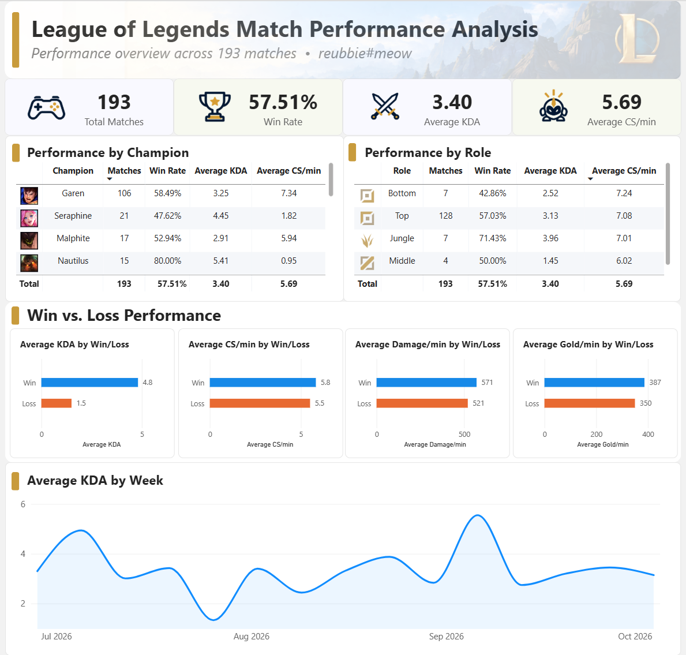
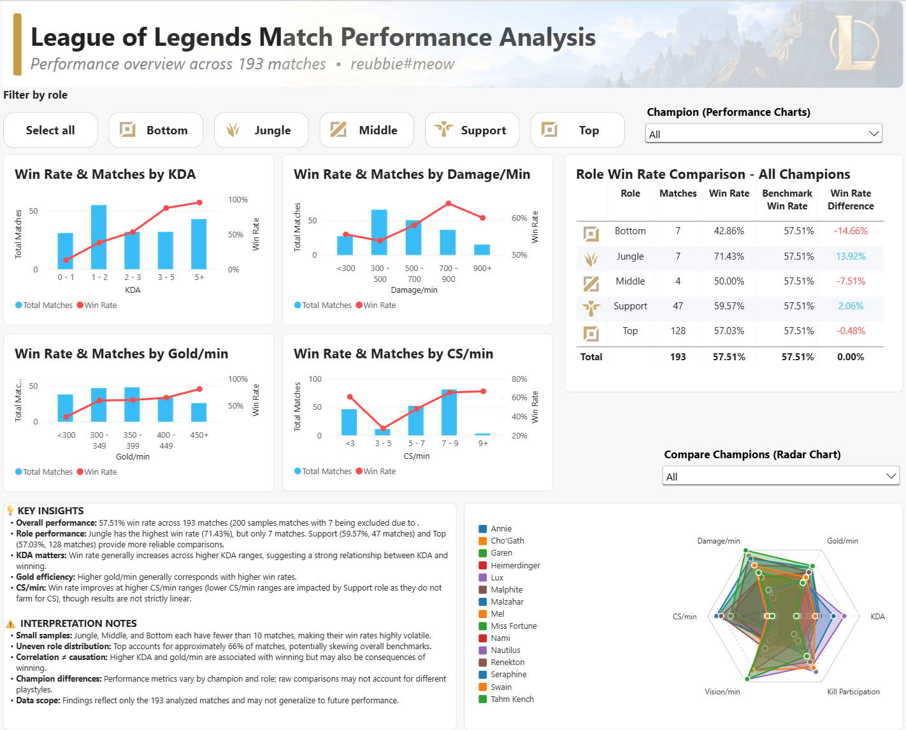

# League of Legends Performance Analysis

**An End-to-End Data Analytics Project Using Python, PostgreSQL, SQL, and Power BI**

## Project Overview

This project analyzes my personal League of Legends match history to identify gameplay patterns, evaluate performance across champions and roles, and explore the relationship between individual performance metrics and winning matches.

I developed an end-to-end data analytics pipeline using the Riot Games API to collect match data, Python to process and load the data into PostgreSQL, SQL to transform the data into an analysis-ready dataset, and Power BI to create interactive dashboards.

The final analysis includes **193 matches**, collected from July to October 2026.

### Project Summary

| Metric | Value  |
|---|--------|
| Matches Collected | 200    |
| Matches Analyzed | 193    |
| Overall Win Rate | 57.51% |
| Average KDA | 3.40   |
| Average CS/min | 5.69   |

## Objectives

The project was designed to answer the following questions:

1. How does my performance vary across different champions and roles?
2. Which gameplay metrics are associated with higher win rates?
3. How do KDA, CS/min, damage per minute, and gold per minute relate to match outcomes?
4. What patterns in my match history could identify opportunities for improvement?
5. How can raw match data be transformed into meaningful, actionable insights?

## Technologies Used

| Technology | Purpose |
|---|---|
| Python | API requests, JSON parsing, data processing, and database loading |
| Riot Games API | Match history and individual match statistics |
| PostgreSQL | Relational database for storing match data |
| SQL | Data transformation, metric calculations, and analytical queries |
| Power BI | Interactive dashboards, data visualization, and DAX measures |
| GitHub | Version control and project documentation |

## Data Pipeline

The project follows an end-to-end Extract, Transform, Load (ETL) workflow.

```text
Riot Games API
      |
      v
Python Data Extraction
      |
      v
JSON Parsing & Processing
      |
      v
PostgreSQL Database
      |
      v
SQL Transformation & Analysis
      |
      v
Analysis-Ready CSV
      |
      v
Power BI Dashboards
```

### 1. Data Extraction

Used Python and the Riot Games API to retrieve match history and detailed match statistics.

The extraction process included:

- Retrieving the player's unique identifier (PUUID)
- Collecting match IDs through the Riot Games API
- Requesting detailed match information for each match
- Extracting player-specific statistics from match participants
- Structuring the data for storage in PostgreSQL

### 2. Data Storage and Transformation

Loaded the processed match data into PostgreSQL for structured querying and analysis.

Used SQL to transform the raw data into an analysis-ready dataset containing:

- Match outcomes (wins and losses)
- Champion and role information
- KDA and individual combat statistics
- Creep score per minute (CS/min)
- Damage per minute
- Gold per minute
- Vision-related statistics

The resulting dataset was exported to CSV for use in Power BI.

### 3. Data Cleaning

Initially collected 200 matches.

During data preparation, I identified seven extremely short or incomplete matches that could distort the analysis. These matches were excluded because their incomplete gameplay statistics could produce misleading per-minute metrics and missing calculated values.

**Final dataset: 193 matches.**

Additional considerations included:

- Using per-minute metrics to compare matches of different durations
- Handling missing or incomplete performance values
- Distinguishing between performance across different roles
- Accounting for small sample sizes when interpreting champion-specific results

### 4. Data Visualization

Imported the analysis-ready dataset into Power BI and developed two interactive dashboards.

The dashboards include calculated measures, champion and role filters, and visual comparisons of gameplay metrics against match outcomes.

## Power BI Dashboards

### Dashboard 1: Match Performance Overview



The first dashboard provides a high-level overview of match performance.

**Key Features:**
- Total matches and overall win rate
- Average KDA and CS/min
- Champion-specific performance
- Role-based win rates
- Win/loss comparisons
- Performance trends across matches

### Dashboard 2: Performance Analysis



The second dashboard explores relationships between individual gameplay metrics and match outcomes.

**Key Features:**
- Win rate by KDA
- Win rate by CS/min
- Win rate by damage per minute
- Win rate by gold per minute
- Champion and role filters
- Role-based performance comparisons

The interactive filters allow users to investigate how performance patterns differ across champions and roles rather than relying exclusively on overall averages.

**[View Power BI Dashboard Files](dashboard/)**

## Key Findings

### 1. Overall Performance

Across 193 analyzed matches, I achieved:

- **57.51% overall win rate**
- **3.40 average KDA**
- **5.69 average CS/min**

These metrics establish a baseline for evaluating individual performance across different champions and roles.

### 2. Performance Varies Significantly by Role

Role-based analysis revealed substantial differences in match outcomes.

| Role   | Win Rate |
|--------|----------|
| Jungle | 71.43%   |
| Top    | 57.03%   |
| Bottom | 42.86%   |

The difference between these roles was approximately **28.57 percentage points**.

This suggests that role selection may be an important factor to investigate when evaluating overall performance.

However, differences in sample size, champion selection, and team composition may contribute to these results. 
Role-based analysis revealed differences in observed win rates, but the small sample sizes for certain roles limit the conclusions that can be drawn. Top lane represented the majority of matches, making it a more useful baseline for evaluating overall performance.

### 3. Damage Output Does Not Always Translate to Wins

Damage-per-minute analysis revealed differences in win rates across damage-output ranges.

Higher damage output did not consistently correspond to higher win rates, suggesting that damage alone is not sufficient to explain match outcomes.

This highlights the importance of interpreting gameplay metrics together rather than using a single statistic as a measure of success.

### 4. Performance Metrics Require Context

Metrics such as CS/min, KDA, gold per minute, and damage per minute can vary substantially by champion and role.

For example, farming expectations and damage output differ between support champions and solo-lane carries.

The dashboards therefore include interactive filtering to support more meaningful comparisons between similar gameplay contexts.

This demonstrates why aggregate performance metrics should not always be interpreted independently of role or champion selection.

## Limitations

This analysis has several limitations:

- **Single-player dataset:** Results reflect one player's match history and cannot be generalized to the broader League of Legends player population.
- **Sample size:** The dataset contains 193 matches, and some champions or roles have substantially fewer observations.
- **Correlation versus causation:** Relationships between performance metrics and winning do not establish that improving a particular metric will cause a higher win rate.
- **Confounding variables:** Champion matchups, team composition, player skill, and other gameplay factors may affect results.
- **Historical snapshot:** Findings reflect the collected match period and may not remain representative as player performance or game balance changes.

## Repository Structure

```text
league-of-legends-data-analysis/
|
|-- src/                  # Python extraction and loading scripts
|-- sql/                  # SQL transformation and analysis
|-- dashboard/            # Power BI dashboard (.pbix)
|-- screenshots/          # Dashboard previews
|-- match_analysis.csv    # Analysis-ready dataset
|-- README.md             # Project documentation
|-- .gitignore
```

## Reproducing the Analysis

### Prerequisites

- Python 3
- PostgreSQL
- Riot Games developer API key
- Power BI Desktop

### Workflow

1. Clone the repository:

   ```bash
   git clone https://github.com/wlee99/league-of-legends-data-analysis.git
   cd league-of-legends-data-analysis
   ```

2. Configure a local PostgreSQL database.

3. Obtain a Riot Games API key from the [Riot Developer Portal](https://developer.riotgames.com/).

4. Configure the required API and database credentials locally.

5. Run the Python extraction and loading scripts in `src/`.

6. Execute the SQL transformation scripts in `sql/`.

7. Export the analysis-ready dataset to CSV.

8. Open the Power BI file in `dashboard/` to explore the visualizations.

**Note:** API credentials and database passwords should be stored locally and must not be committed to the repository.

The included `match_analysis.csv` can also be used to explore the existing analysis without collecting new match data.

## Conclusion

This project demonstrates an end-to-end data analytics workflow, from collecting raw API data and transforming it into a structured dataset to developing interactive dashboards and communicating analytical findings.

Beyond the technical implementation, the project emphasizes data quality, meaningful metric selection, exploratory analysis, and the importance of interpreting results within their appropriate context.

### Skills Demonstrated

**Python | SQL | PostgreSQL | Power BI | REST APIs | ETL | Data Cleaning | Data Visualization | Exploratory Data Analysis**

---

*League of Legends is a trademark of Riot Games. This is an independent personal analytics project and is not endorsed by Riot Games.*
